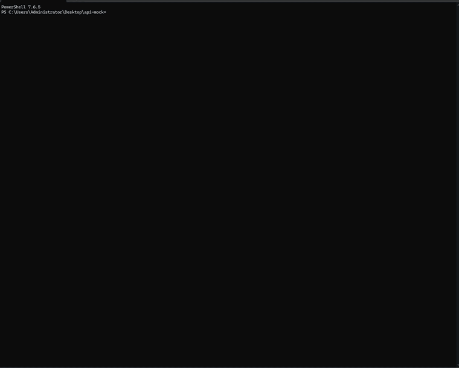

# 🧩 opencode-skills-tui

<p align="center">
  <a href="README.md">English</a> | <a href="README.zh-CN.md">简体中文</a>
</p>

<p align="center">
  <a href="https://www.npmjs.com/package/opencode-skills-tui"></a>
  <a href="https://www.npmjs.com/package/opencode-skills-tui"></a>
  <a href="LICENSE"></a>
</p>

Browse skills, track loaded state, preview SKILL.md, and insert skill attachments from the [OpenCode](https://opencode.ai) terminal sidebar.



## 📦 Install / update / remove

Requires **OpenCode ≥ 2.0**. Terminal UI (TUI) only.

```bash
# Install / update / remove
opencode plugin add/update/remove opencode-skills-tui
```

Replace `add/update/remove` with the desired subcommand before running.

On V1, see the [V1 guide](https://github.com/aihaipeng/opencode-skills-tui/blob/v0.4.4/README.md).

## ⚙️ Parameters

Run `/skills-sidebar` to open the settings panel.

| Setting | Description | Available values |
| --- | --- | --- |
| Show sidebar | Show or hide the panel | `on` / `off` |
| Display scope | Choose which skills to show (see below) | `model-visible` / `registered` / `loaded-only` |
| Token estimation | Show static token estimates | `list entry` / `load cost` / `total cost` / `off` |
| Header counts | Show skill counts in the header | `on` / `off` |
| Skill overview | Choose the mouse button for a read-only preview | `left-click` / `middle-click` / `right-click` / `off` |
| Insert @mention | Choose the mouse button for inserting a native skill attachment into the prompt | `left-click` / `middle-click` / `right-click` / `off` |

- **Display scope:**
  - `model-visible`: skills the model can discover and invoke automatically.
  - `loaded-only`: only skills successfully loaded in the current stage, including hidden skills.
  - `registered`: all skills registered for the host's current directory, including hidden skills.

  **Hidden skills:** omitted from the model's available list by metadata or permission rules, **not offered for automatic discovery/invocation**, but can be explicitly loaded with `@skill-id`. Hidden does not mean loading is disabled.

  Every scope retains current-stage loaded IDs. Loaded skills are highlighted and pinned to the top; unloaded hidden skills stay muted. Automatic invocation still follows the host's permission rules. Display scope does not change permissions, and hiding the panel does not disable skills.
- **Token estimation:**
  - `list entry`: estimated tokens for a model-visible listing entry (ID, name, description), without the skill body; hidden entries cost `0`.
  - `load cost`: estimated additional tokens for one ordinary load, including the body and host-added information.
  - `total cost`: per-skill `list entry + load cost`, regardless of whether the skill is currently loaded.

  These are static estimates, not live context usage, cumulative consumption or billing; unavailable values show `-`.

Settings persist across sessions and restarts and sync across local TUI instances; collapse stays per-terminal.

## 💡 Notes

- **Unloaded after compaction:** OpenCode's context compaction (`/compact`) is [lossy](https://opencode.ai/v2/docs/compaction/) and does not guarantee continued adherence to skill instructions. Successful compaction resets load marks; a new successful load highlights the skill again. `loaded` counts distinct successfully loaded skills since session start or the latest successful compaction, not invocations. Unloaded does not mean all skill text is absent from context.
- **Preview:** locally readable SKILL.md takes priority; otherwise the host's registered body is shown. Preview text may differ from model input. Ctrl+click rendered HTTP(S) links to open them in your browser.

## 📁 Source structure

```text
opencode-skills-tui/
├── src/
│   ├── tui.tsx                 # Plugin setup, preview, and native skill attachments
│   ├── skill-data.ts           # Skill visibility, load state, and token estimates
│   ├── open-link.ts            # Ctrl+click link opening
│   └── components/
│       ├── skills-panel.tsx    # Sidebar panel
│       └── skills-dialog.tsx   # Sidebar settings dialog
├── scripts/                    # Build and package validation
├── test/                       # Regression tests
├── assets/                     # Demo media
├── dist/                       # Generated TUI bundle
├── index.ts                    # Required no-op server entry
└── tui.tsx                     # Forwards to the compiled TUI bundle
```

## 🛠️ Local development

In a local checkout, use [Bun](https://bun.sh):

```bash
bun install
bun run build
bun run test
```

Replace the npm entry with the checkout's absolute `file://` URL in the existing `plugins` array in `opencode.json(c)`. Rebuild and restart the TUI after code changes.

[OpenCode plugin docs](https://opencode.ai/v2/docs/plugins) · [MIT license](LICENSE)
